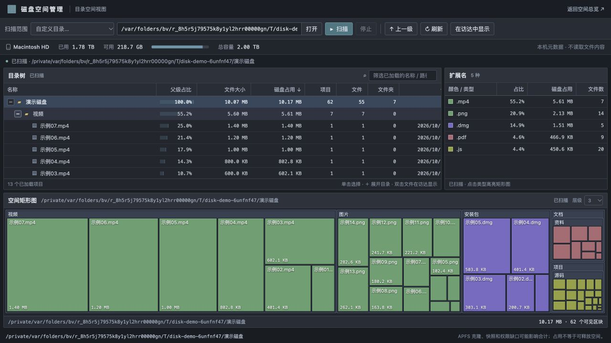

# 磁盘空间管理

在 Mac 上查找占空间的文件，用目录树、扩展名统计和矩形图查看分布，再一键到 Finder 定位。界面借鉴 WizTree 的信息布局，代码独立实现，采用 MIT 许可证。



## 安装与启动

适用目标：**macOS 12 或更新版本，Intel / Apple Silicon，Python 3.10+**。已在 macOS 26.5.2 / Apple Silicon / Python 3.12 上验证安装、页面扫描和 Finder 定位；Intel 辅助程序在 Rosetta 下通过测试，其他系统版本仍需实机反馈。当前提供源码安装包，**尚未内置 Python，也未经 Apple 公证**，不能承诺所有 Mac 都可直接双击运行。没有 Python 时，请先从 [Python 官网](https://www.python.org/downloads/macos/) 安装适用于你的系统的版本。

1. 在 [Releases](https://github.com/mli-chwy/mac-disk-space-cleaner/releases) 下载 `disk-space-analyzer-v0.2.1-macos-source.zip`，解压。
2. 双击 **安装到应用程序.command**。安装器会创建 `磁盘空间管理.app` 和同名桌面入口；没有 `/Applications` 写入权限时使用 `~/Applications`。
3. 双击桌面的 **磁盘空间管理**，等待本机服务就绪，浏览器会打开“目录空间视图”。重复启动会复用同一版本的服务。

如果从 GitHub 的 Code → Download ZIP 下载源码，脚本可能没有执行权限，可在终端进入解压目录运行 `bash scripts/install_macos.sh`。系统若因下载来源拦截，请先核实来源，再按 macOS 提示自行决定是否打开。不要关闭系统安全保护。

不安装也可双击 **启动磁盘空间管理.command**。开发者可以运行：

```bash
python3 launcher.py
```

## 使用

- **目录空间视图**：选择目录，点击“扫描”，得到各级目录占用、文件数、文件夹数、扩展名比例和多层矩形图。扫描可停止；未扫描或无权限的位置会标明缺口。
- **找文件**：点目录前的 `+` 展开，点表头排序。点击矩形选择项目，双击文件或点击 **在访达中显示**，Finder 会定位并选中文件。
- **空间总览**：页面右上角可切换。Spotlight 快速查询大文件、按名称搜索；应用程序列表显示 `.app` 本体占用。
- **清理**：先在 Finder 确认用途。空间总览还提供“复核 → 移入废纸篓”，需要原生辅助程序可用；不会自动清空废纸篓。应用本体删除不等于完整卸载，后台服务、许可证和支持数据请按软件自己的卸载说明处理。

## 索引、统计与权限

Spotlight 使用 macOS 自带的 `mdfind` 索引，适合快速寻找已收录的大文件。它可能忽略隐藏目录、隐私目录、未索引卷或新文件，因此不能替代完整的目录占用统计。只有点击“扫描”才递归遍历所选目录，读取名称、大小和时间等元数据，不读取文件正文；常规使用无需 AI、API Key 或付费模型，也不消耗模型 token。

“文件大小”是逻辑长度，“磁盘占用”按文件系统报告的分配块计算。硬链接只计一次分配空间；稀疏文件、APFS 克隆、压缩、快照、可清除空间以及权限限制会让结果与系统储存空间不同。**显示的占用不等于删除后立即释放的空间。** 数值采用十进制单位，1 GB = 1,000,000,000 B。

扫描不跟随符号链接，不自动跨入其他挂载卷。启动卷根目录会包含 APFS 数据卷的常见映射，并跳过重复入口；外置磁盘请单独选择扫描。统计对应扫描时点，文件变化后请重新扫描。后台仅保留一份最近扫描快照，目录树按需加载，矩形图合并过多的小项；“其余项目”汇总块没有对应单个文件，不能到 Finder 定位。

出现“部分结果”时查看权限错误提示。需要查看受保护目录时，可以自行在系统设置 → 隐私与安全性 → 完全磁盘访问权限中授权实际启动程序或 Python，再重新扫描。程序不会自动获取管理员权限或修改系统权限。

## 本地数据与启动问题

服务只监听 `127.0.0.1:8799`，请求校验 Host、Origin，写操作另需当前进程令牌。网页不加载外部字体、脚本或统计服务。扫描快照、日志和安装备份保存在：

```text
~/Library/Application Support/磁盘空间管理/
```

这些数据可能包含你的文件路径，仅存于本机，不随源码或发行包发布。不要将它们附到公开 Issue。旧项目目录下的 `.state` 快照不自动迁移，需要重新扫描。

端口被其他程序或旧版占用时，启动器会提示，不会结束未知进程。退出已确认的旧服务后重试，或运行 `python3 launcher.py --port 8800`。关闭浏览器页面不会结束后台服务；可以在“活动监视器”中核实命令路径后退出对应 Python 进程。

可选环境变量：`ATLAS_PYTHON` 指定 Python 可执行文件；`ATLAS_STATE_DIR` 指定本地状态目录；`DISK_ANALYZER_PORT` 指定启动端口。

## 原生废纸篓辅助程序

发行包可包含 `bin/trash-helper-arm64` 和 `bin/trash-helper-x86_64`，由仓库中的 `trash_helper.swift` 构建。辅助程序不可用时，页面会禁用移入操作，仍可到 Finder 手动处理；运行时不会安装 Xcode 或自动编译。

开发者已安装 Apple 命令行工具时可重建：

```bash
mkdir -p bin
xcrun swiftc -O -target arm64-apple-macosx12.0 trash_helper.swift -o bin/trash-helper-arm64
xcrun swiftc -O -target x86_64-apple-macosx12.0 trash_helper.swift -o bin/trash-helper-x86_64
```

## 开发与验证

Python 标准库后端，原生 HTML/CSS/JavaScript 前端，无需 npm 安装。运行：

```bash
python3 -m unittest discover -v
node --check app.js
node --check classic.js
python3 scripts/build_release.py
```

测试覆盖扫描统计、硬链接/稀疏文件、部分结果、取消、矩形图预算、请求隔离、删除前复核，以及启动和打包。CI 配置 Intel 与 Apple Silicon 的 macOS runner，Python 3.10 / 3.12。具体运行结果见 [Actions](https://github.com/mli-chwy/mac-disk-space-cleaner/actions)，不能据此声称所有 macOS 版本均已实机验证。

源码包由白名单生成，排除扫描缓存、日志、个人路径数据和开发环境。欢迎提交可复现的问题；请附 macOS 版本、芯片架构、Python 版本，以及去掉私人路径的错误信息。

## 许可证

[MIT](LICENSE)，Copyright (c) 2026 mli-chwy。WizTree 名称属于其权利人，本项目与其没有隶属关系。
